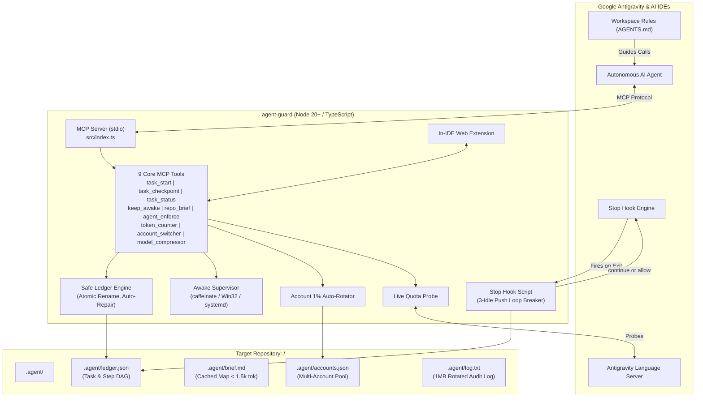

<p align="center">
  
</p>

<h1 align="center">Agent Guard</h1>

<p align="center">
  <strong>Autonomous AI agent supervisor, crash-proof DAG ledger, multi-account 1% auto-rotator, and keep-awake lease engine.</strong>
</p>

<p align="center">
  <a href="LICENSE"></a>
  <a href="#test-suite"></a>
  <a href="docs/AWESOME_SKILLS.md"></a>
  <a href="#zero-telemetry"></a>
  
  <a href="#mention-agent-guard"></a>
  <a href="#auto-update"></a>
  <a href="#prerequisites">= 20" /></a>
</p>

<p align="center">
  <strong>Developer</strong>: <a href="https://github.com/anksarvesh-lgtm">Sarvesh</a> |
  <strong>GitHub</strong>: <a href="https://github.com/anksarvesh-lgtm/agent-guard">anksarvesh-lgtm/agent-guard</a>
</p>

---

## ⚡ Instant Setup (One Command / One Prompt)

### 💻 One Terminal Command (Auto-Detects All Installed Coding Apps):
```bash
curl -fsSL https://raw.githubusercontent.com/anksarvesh-lgtm/agent-guard/main/install.sh | bash
```
*Auto-detects and configures **Google Antigravity**, **Claude Code**, **Cursor**, **Codex CLI**, **Gemini CLI**, **Windsurf**, **VS Code (Cline/Roo)**, and **Zed**.*

### 🤖 Universal Agent Prompt (Copy & Paste to Any AI Agent):
> **"Please install and activate the Agent Guard MCP supervisor (https://github.com/anksarvesh-lgtm/agent-guard.git). Run `curl -fsSL https://raw.githubusercontent.com/anksarvesh-lgtm/agent-guard/main/install.sh | bash` in the terminal, verify with `node ~/.agent-guard/dist/cli.js doctor`, and adopt the `@agent-guard` rules to supervise all my development tasks with atomic ledger checkpoints and keep-awake protection."**

---

## Why Agent Guard?

Autonomous AI coding agents in modern IDEs like Google Antigravity excel at single-turn instructions, but frequently encounter catastrophic failure modes during extended, multi-step work:

1. **Premature Abandonment**: The agent declares victory and halts before running tests or finishing dependent steps.
2. **Context Window Bloat & Cost Spikes**: Repeatedly crawling deep file hierarchies and receiving thousands of redundant tokens in status output.
3. **Session Amnesia**: When a chat hits context limits or crashes, all task memory is lost and the agent restarts from scratch.
4. **Unattended Sleep**: Complex tasks stall midway because the computer's display or idle sleep kicks in while you step away.
5. **Quota Exhaustion Mid-Execution**: Automated pairing sessions fail abruptly when model quotas reach 0% or hit rate limit barriers.

**Agent Guard** (`agent-guard`) solves all five problems with zero external infrastructure:
- 💾 **File-Backed Atomic DAG Ledger**: Keeps track of every step in `.agent/ledger.json` with self-healing recovery and concurrency locking.
- 🛑 **Antigravity Stop Hook**: Soft-blocks premature termination until all tasks are complete, with an integrated loop breaker.
- ☕ **Supervised Keep-Awake Lease**: Keeps the computer awake using native OS tools (`caffeinate` / `SetThreadExecutionState` / `systemd-inhibit`) with an 8-hour safety ceiling.
- 🔄 **1% Quota Auto-Rotator**: Continuously tracks model quota and seamlessly switches accounts when quota reaches $\le 1\%$.
- ⚡ **Accurate Token Counter**: Multi-model token measurement (Gemini, Claude, GPT-4o, DeepSeek) and session budget protection.
- 📉 **Model Context Compression**: Structural context and token pruning via LightCompress reconstruction.
- 🌐 **In-IDE Webview Extension**: Live token burn, remaining quota, task dashboard, and click-to-check update indicators.
- 🤖 **Chat Mention `@agent-guard`**: Summon Agent Guard directly in Antigravity or AI coding chat by typing `@agent-guard`.

---

## System Architecture



---

## Core Pillars & Capabilities

### 1. 🛡️ Zero Telemetry & Local Sandboxing
* **100% Offline & Private**: Zero network dependencies, zero tracking, no cloud telemetry.
* **Strict Path Sandboxing**: Resolves canonical realpaths; strictly jails writes to `<project>/.agent/`. Disallows root directory, user home directory, and uninitialized paths.

### 2. 💾 Crash-Proof, Self-Healing State Ledger
* **Atomic Writes**: Writes to `.agent/ledger.tmp` followed by atomic filesystem `rename`.
* **Lock Contention**: Concurrency locking (`.agent/ledger.lock`) with 30-second stale lock eviction.
* **Automatic Recovery**: Backs up prior state to `ledger.prev.json` before writing; automatically self-heals and restores state if corruption is ever detected on read.

### 3. 🔄 1% Quota Auto-Rotator & Account Pool
* Continuously probes active session quota via Antigravity Language Server and proxy balance.
* Automatically triggers rotation when quota $\le 1.0\%$, seamlessly switching credentials without disturbing running tasks.
* Supports Antigravity OAuth tokens, Claude API keys, OpenAI tokens, and custom proxy endpoints.

### 4. ⚡ Multi-Model Token Counter & Cost Monitor
* Real-time token calculation across **Gemini**, **Claude 3.5 Sonnet**, **GPT-4o**, and **DeepSeek**.
* Analyzes raw text snippets, project files, or conversation transcripts (`transcript.jsonl`).
* Context budget alerts prevent agents from crossing prompt limits.

### 5. 📉 Model & Context Compression (LightCompress REA)
* Structural pruning of bloated outputs, verbose stack traces, and boilerplate logs.
* Memory footprint estimator for LLMs, VLMs, and diffusion models (1B to 671B parameters).
* Quantization and deployment config generation (W4A16, FP8, INT4).

### 6. ☕ Supervised Keep-Awake Leases
* Prevents unattended computers from sleeping during long builds, tests, or multi-step execution.
* Native OS helpers:
  * **macOS**: `caffeinate -di -t <sec> -w <pid>` with seamless child swapping (no sleep gap).
  * **Windows**: PowerShell `SetThreadExecutionState` continuous wrapper.
  * **Linux**: `systemd-inhibit --what=idle:sleep`.
* Auto-expiring lease renewed at every checkpoint, guarded by an **8-hour hard ceiling**.

### 7. 🛑 Antigravity Stop Hook & Loop Breaker
* Wired via Antigravity's `.agents/hooks.json`.
* Detects premature agent stops: if unfinished, unblocked steps remain, soft-pushes the agent back to continue.
* **Loop Breaker**: If the agent makes no checkpoint progress for 3 consecutive pushes, or reaches 10 total pushes, allows stop to prevent runaway loops.

---

## MCP Tools Reference

| Tool | Purpose | Token Cost | Key Inputs |
| :--- | :--- | :--- | :--- |
| `task_start` | Starts a tracked task, validates step DAG, begins 30m awake lease | ~150 tokens | `goal`, `steps`, `max_tries?`, `replace?`, `project_path?` |
| `task_checkpoint` | Reports progress (`in_progress`, `done`, `failed`), verifies proof, extends lease | ~60 tokens | `step_id`, `status`, `note`, `error?`, `add_steps?`, `project_path?` |
| `task_status` | Read-only inspection of active step, blocked items, and next action | < 500 tokens | `project_path?` |
| `keep_awake` | Explicitly holds, releases, or inspects sleep inhibition lease | ~40 tokens | `action` (`hold`/`release`/`status`), `minutes?`, `reason?` |
| `repo_brief` | Fast project overview with ASCII directory map & architecture chart | < 1,500 tokens | `refresh?`, `project_path?` |
| `agent_enforce` | Communicates directives with active agents and forces task completion | ~60 tokens | `action` (`status`/`broadcast`/`force_next`), `directive?` |
| `token_counter` | Measures tokens and costs across Gemini, Claude, GPT-4o, and DeepSeek | ~80 tokens | `model?`, `text?`, `file_path?`, `transcript_path?`, `compare_all?` |
| `account_switcher` | Rotates accounts and manages auto-rotation when quota hits 1% | ~70 tokens | `action` (`status`/`switch`/`add`/`auto_rotate`), `account_id?` |
| `model_compressor` | Quantizes models, prunes tokens, and estimates memory savings | ~90 tokens | `action` (`estimate`/`recommend`/`generate_config`), `param_billions?` |

---

## 🛠️ Unified CLI Reference

Agent Guard includes an exhaustive command-line interface:

```bash
# Diagnostic & Installation
node dist/cli.js doctor                       # Complete integration & readiness health check
node dist/cli.js install                      # Universal multi-app auto-installer
node dist/cli.js auto-accept                  # Grant autoApprove permissions across all IDEs

# Task & Supervised Sleep
node dist/cli.js awake status                 # Check OS sleep inhibition status
node dist/cli.js awake hold --minutes 45      # Request a 45-minute keep-awake lease
node dist/cli.js awake release                # Release active sleep lease

# Quota & Token Monitoring
node dist/cli.js tokens                       # View session token count and active model budget
node dist/cli.js tokens --live                # Synchronously query Antigravity live quota

# Multi-Account Management
node dist/cli.js accounts status              # Inspect accounts pool and active quota %
node dist/cli.js accounts switch --name work  # Switch active profile to "work"
node dist/cli.js accounts rotate              # Manually trigger quota failover check

# Model & Context Compression
node dist/cli.js compress --file trace.log    # Compress verbose file before sending to model
node dist/cli.js compress estimate -p 70      # Estimate memory for 70B parameter model

# In-IDE Extension & Dashboard
node dist/cli.js extension status             # Check extension build and version status
node dist/cli.js extension install            # Re-link web extension in Antigravity IDE
node dist/cli.js update                       # Self-update Agent Guard from GitHub origin/main
```

---

## 🚀 App-by-App Installation Guide & Agent Configuration Recipes

Agent Guard seamlessly integrates into any autonomous coding application using standard Model Context Protocol (MCP) configuration over `stdio`. Use the automated installer (`./install.sh`) or manually add the configuration snippets below:

<details open>
<summary><strong>1. Google Antigravity (IDE, App 2.0 & CLI <code>agy</code>)</strong></summary>

**Configuration Path**: `~/.gemini/config/mcp_config.json`
```json
{
  "mcpServers": {
    "agent-guard": {
      "command": "node",
      "args": ["/Users/sarvesh/Downloads/mcp/agent-guard/dist/index.js"]
    }
  }
}
```

**Antigravity Stop Hook** (`<project>/.agents/hooks.json`):
```json
{
  "agent-guard-stop": {
    "Stop": [
      {
        "type": "command",
        "command": "node /Users/sarvesh/Downloads/mcp/agent-guard/dist/hook/stop-hook.js"
      }
    ]
  }
}
```

**Chat Mention**: Summon directly in any chat:
```text
@agent-guard run complete audit and tests before committing
```
</details>

<details>
<summary><strong>2. Claude Code CLI (Anthropic)</strong></summary>

**One-Line CLI Setup**:
```bash
claude mcp add agent-guard -- node /Users/sarvesh/Downloads/mcp/agent-guard/dist/index.js
```

**Configuration Path**: `~/.claude/mcp.json` or `~/.claude.json`
```json
{
  "mcpServers": {
    "agent-guard": {
      "command": "node",
      "args": ["/Users/sarvesh/Downloads/mcp/agent-guard/dist/index.js"],
      "autoApprove": [
        "task_start",
        "task_checkpoint",
        "task_status",
        "keep_awake",
        "repo_brief",
        "agent_enforce",
        "token_counter",
        "account_switcher",
        "model_compressor"
      ]
    }
  }
}
```
</details>

<details>
<summary><strong>3. Cursor IDE</strong></summary>

**Configuration Path**: `~/.cursor/mcp.json`
```json
{
  "mcpServers": {
    "agent-guard": {
      "command": "node",
      "args": ["/Users/sarvesh/Downloads/mcp/agent-guard/dist/index.js"]
    }
  }
}
```

**System Prompt / Rules** (`<project>/.cursorrules`):
```text
Supervised by Agent Guard:
- Check task_status or call repo_brief on session start.
- Break down tasks with task_start.
- Checkpoint each step with test proofs using task_checkpoint.
```
</details>

<details>
<summary><strong>4. Windsurf / Cascade (Codeium)</strong></summary>

**Configuration Path**: `~/.codeium/windsurf/mcp_config.json`
```json
{
  "mcpServers": {
    "agent-guard": {
      "command": "node",
      "args": ["/Users/sarvesh/Downloads/mcp/agent-guard/dist/index.js"]
    }
  }
}
```
</details>

<details>
<summary><strong>5. VS Code (Cline / Roo Code)</strong></summary>

**Configuration Path**: `cline_mcp_settings.json`
```json
{
  "mcpServers": {
    "agent-guard": {
      "command": "node",
      "args": ["/Users/sarvesh/Downloads/mcp/agent-guard/dist/index.js"],
      "disabled": false,
      "autoApprove": [
        "task_start",
        "task_checkpoint",
        "task_status",
        "keep_awake",
        "repo_brief",
        "agent_enforce",
        "token_counter",
        "account_switcher",
        "model_compressor"
      ]
    }
  }
}
```
</details>

<details>
<summary><strong>6. Codex CLI & Gemini CLI</strong></summary>

**Configuration Path**: `~/.codex/mcp.json` or `$CODEX_HOME/mcp.json`
```json
{
  "mcpServers": {
    "agent-guard": {
      "command": "node",
      "args": ["/Users/sarvesh/Downloads/mcp/agent-guard/dist/index.js"]
    }
  }
}
```
</details>

<details>
<summary><strong>7. Zed Editor</strong></summary>

**Configuration Path**: `~/.config/zed/settings.json`
```json
{
  "experimental": {
    "model_context_protocol": {
      "servers": {
        "agent-guard": {
          "command": "node",
          "args": ["/Users/sarvesh/Downloads/mcp/agent-guard/dist/index.js"]
        }
      }
    }
  }
}
```
</details>

---

---

## 🧪 Test Suite & Quality Verification

Agent Guard is verified by an exhaustive 16-suite Vitest test harness:

```bash
npm test
```

```text
 RUN  v3.2.7 /Users/sarvesh/Downloads/mcp/agent-guard

 ✓ test/tokenCounter.test.ts (14 tests)
 ✓ test/liveQuota.test.ts (10 tests)
 ✓ test/stepRules.test.ts (7 tests)
 ✓ test/appInstall.test.ts (8 tests)
 ✓ test/skills.test.ts (10 tests)
 ✓ test/stopHook.test.ts (4 tests)
 ✓ test/repoBrief.test.ts (4 tests)
 ✓ test/update.test.ts (4 tests)
 ✓ test/accountSwitcher.test.ts (11 tests)
 ✓ test/tools.test.ts (7 tests)
 ✓ test/extension.test.ts (8 tests)
 ✓ test/ledger.test.ts (6 tests)
 ✓ test/modelCompressor.test.ts (8 tests)
 ✓ test/agentEnforce.test.ts (5 tests)
 ✓ test/paths.test.ts (8 tests)
 ✓ test/keepAwake.test.ts (7 tests)

 Test Files  16 passed (16)
      Tests  123 passed (123)
   Duration  3.11s
```

---

## 🌟 Curated Skills Catalog (14 Bundled / 2,740+ Awesome Catalog)

Agent Guard automatically deploys **14 curated core skills** to all detected IDEs:
1. `agent-guard`: Autonomous task supervisor and keep-awake lease guard.
2. `ai-agents-architect`: Multi-agent system architecture and ReAct tool routing.
3. `clean-architecture`: Domain-driven boundaries and decoupled modularity.
4. `devops-automation`: CI/CD workflows, Docker containerization, and automated releases.
5. `security-audit`: Zero-trust vulnerability audit and secret leakage prevention.
6. `test-driven-development`: Red-Green-Refactor enforcement with verifiable test proofs.
7. `performance-profiling`: V8 heap analysis, event-loop latency, and hot-path tuning.
8. `reverse-engineering`: Binary inspection, AST reconstruction, and protocol analysis.
9. `ui-ux-pro-max`: Design intelligence tokens, typography, and styling systems.
10. `frontend-design`: Aesthetic direction and bespoke design components.
11. `web-artifacts-builder`: Modern frontend interactive artifact generation (React/Tailwind/shadcn).
12. `mcp-builder`: FastMCP and TypeScript MCP server development guide.
13. `code-review-and-quality`: Multi-axis quality and security PR review engine.
14. `debugging-and-error-recovery`: Systematic root-cause debugging and fault localization.

Explore the broader collection of **2,740+ skills** in [docs/AWESOME_SKILLS.md](docs/AWESOME_SKILLS.md).

---

## 👨‍💻 Developer & Author

* **Developer**: **Sarvesh** ([@anksarvesh-lgtm](https://github.com/anksarvesh-lgtm))
* **Project Repository**: [https://github.com/anksarvesh-lgtm/agent-guard](https://github.com/anksarvesh-lgtm/agent-guard)

---

## 📄 License

Agent Guard is free and open-source software licensed under the **[Apache License, Version 2.0](LICENSE)**.
