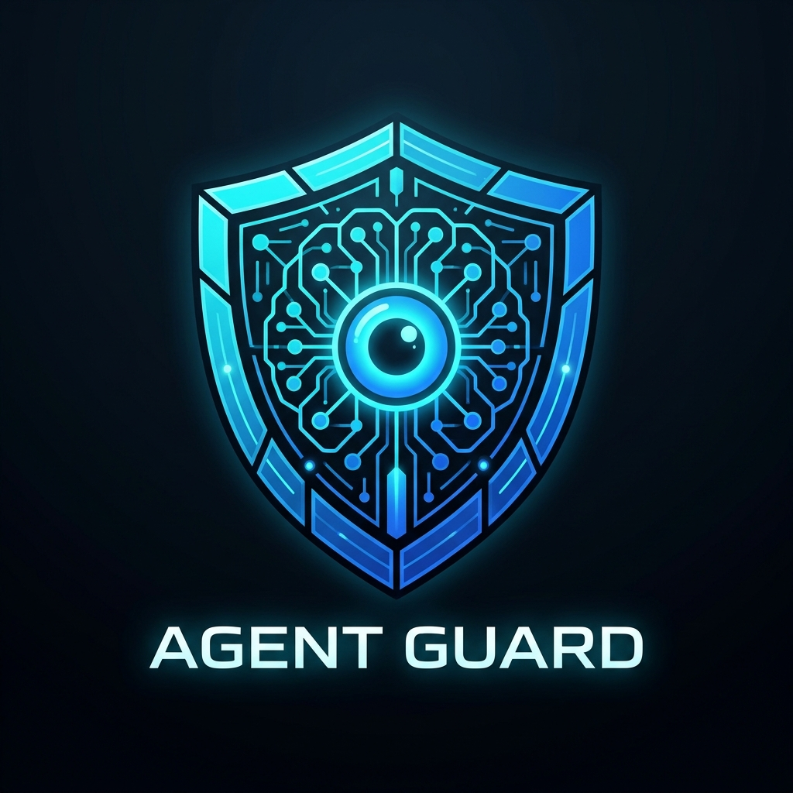
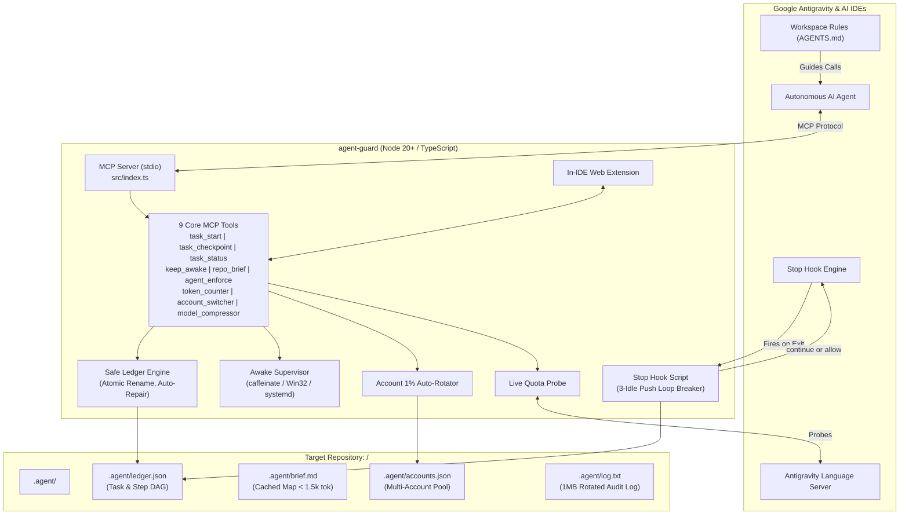

<p align="center">
  
</p>

<h1 align="center">Agent Guard</h1>

<p align="center">
  <strong>Autonomous AI agent supervisor, crash-proof DAG ledger, multi-account 1% auto-rotator, and keep-awake lease engine.</strong>
</p>

<p align="center">
  <a href="LICENSE"></a>
  <a href="#test-suite"></a>
  <a href="#-active-skills-catalog-269-active--3790-library"></a>
  <a href="#zero-telemetry"></a>
  
  <a href="#mention-agent-guard"></a>
  <a href="#auto-update"></a>
  <a href="#prerequisites">= 20" /></a>
</p>

<p align="center">
  <strong>Developer</strong>: <a href="https://github.com/anksarvesh-lgtm">Sarvesh</a> |
  <strong>GitHub</strong>: <a href="https://github.com/anksarvesh-lgtm/agent-guard">anksarvesh-lgtm/agent-guard</a>
</p>

---

## ⚡ Instant Setup (One Command / One Prompt)

### 💻 One Terminal Command (Auto-Detects All Installed Coding Apps):
```bash
curl -fsSL https://raw.githubusercontent.com/anksarvesh-lgtm/agent-guard/main/install.sh | bash
```
*Auto-detects and configures **Google Antigravity**, **Claude Code**, **Cursor**, **Codex CLI**, **Gemini CLI**, **Windsurf**, **VS Code (Cline/Roo)**, and **Zed**.*

### 🤖 Universal Agent Prompt (Copy & Paste to Any AI Agent):
> **"Please install and activate the Agent Guard MCP supervisor (https://github.com/anksarvesh-lgtm/agent-guard.git). Run `curl -fsSL https://raw.githubusercontent.com/anksarvesh-lgtm/agent-guard/main/install.sh | bash` in the terminal, verify with `node ~/.agent-guard/dist/cli.js doctor`, and adopt the `@agent-guard` rules to supervise all my development tasks with atomic ledger checkpoints and keep-awake protection."**

---

## Why Agent Guard?

Autonomous AI coding agents in modern IDEs like Google Antigravity excel at single-turn instructions, but frequently encounter catastrophic failure modes during extended, multi-step work:

1. **Premature Abandonment**: The agent declares victory and halts before running tests or finishing dependent steps.
2. **Context Window Bloat & Cost Spikes**: Repeatedly crawling deep file hierarchies and receiving thousands of redundant tokens in status output.
3. **Session Amnesia**: When a chat hits context limits or crashes, all task memory is lost and the agent restarts from scratch.
4. **Unattended Sleep**: Complex tasks stall midway because the computer's display or idle sleep kicks in while you step away.
5. **Quota Exhaustion Mid-Execution**: Automated pairing sessions fail abruptly when model quotas reach 0% or hit rate limit barriers.

**Agent Guard** (`agent-guard`) solves all five problems with zero external infrastructure:
- 💾 **File-Backed Atomic DAG Ledger**: Keeps track of every step in `.agent/ledger.json` with self-healing recovery and concurrency locking.
- 🛑 **Antigravity Stop Hook**: Soft-blocks premature termination until all tasks are complete, with an integrated loop breaker.
- ☕ **Supervised Keep-Awake Lease**: Keeps the computer awake using native OS tools (`caffeinate` / `SetThreadExecutionState` / `systemd-inhibit`) with an 8-hour safety ceiling.
- 🔄 **1% Quota Auto-Rotator**: Continuously tracks model quota and seamlessly switches accounts when quota reaches $\le 1\%$.
- ⚡ **Accurate Token Counter**: Multi-model token measurement (Gemini, Claude, GPT-4o, DeepSeek) and session budget protection.
- 📉 **Model Context Compression**: Structural context and token pruning via LightCompress reconstruction.
- 🌐 **In-IDE Webview Extension**: Live token burn, remaining quota, task dashboard, and click-to-check update indicators.
- 🤖 **Chat Mention `@agent-guard`**: Summon Agent Guard directly in Antigravity or AI coding chat by typing `@agent-guard`.

---

## System Architecture



---

## Core Pillars & Capabilities

### 1. 🛡️ Zero Telemetry & Local Sandboxing
* **100% Offline & Private**: Zero network dependencies, zero tracking, no cloud telemetry.
* **Strict Path Sandboxing**: Resolves canonical realpaths; strictly jails writes to `<project>/.agent/`. Disallows root directory, user home directory, and uninitialized paths.

### 2. 💾 Crash-Proof, Self-Healing State Ledger
* **Atomic Writes**: Writes to `.agent/ledger.tmp` followed by atomic filesystem `rename`.
* **Lock Contention**: Concurrency locking (`.agent/ledger.lock`) with 30-second stale lock eviction.
* **Automatic Recovery**: Backs up prior state to `ledger.prev.json` before writing; automatically self-heals and restores state if corruption is ever detected on read.

### 3. 🔄 1% Quota Auto-Rotator & Account Pool
* Continuously probes active session quota via Antigravity Language Server and proxy balance.
* Automatically triggers rotation when quota $\le 1.0\%$, seamlessly switching credentials without disturbing running tasks.
* Supports Antigravity OAuth tokens, Claude API keys, OpenAI tokens, and custom proxy endpoints.

### 4. ⚡ Multi-Model Token Counter & Cost Monitor
* Real-time token calculation across **Gemini**, **Claude 3.5 Sonnet**, **GPT-4o**, and **DeepSeek**.
* Analyzes raw text snippets, project files, or conversation transcripts (`transcript.jsonl`).
* Context budget alerts prevent agents from crossing prompt limits.

### 5. 📉 Model & Context Compression (LightCompress REA)
* Structural pruning of bloated outputs, verbose stack traces, and boilerplate logs.
* Memory footprint estimator for LLMs, VLMs, and diffusion models (1B to 671B parameters).
* Quantization and deployment config generation (W4A16, FP8, INT4).

### 6. ☕ Supervised Keep-Awake Leases
* Prevents unattended computers from sleeping during long builds, tests, or multi-step execution.
* Native OS helpers:
  * **macOS**: `caffeinate -di -t <sec> -w <pid>` with seamless child swapping (no sleep gap).
  * **Windows**: PowerShell `SetThreadExecutionState` continuous wrapper.
  * **Linux**: `systemd-inhibit --what=idle:sleep`.
* Auto-expiring lease renewed at every checkpoint, guarded by an **8-hour hard ceiling**.

### 7. 🛑 Antigravity Stop Hook & Loop Breaker
* Wired via Antigravity's `.agents/hooks.json`.
* Detects premature agent stops: if unfinished, unblocked steps remain, soft-pushes the agent back to continue.
* **Loop Breaker**: If the agent makes no checkpoint progress for 3 consecutive pushes, or reaches 10 total pushes, allows stop to prevent runaway loops.

---

## MCP Tools Reference

| Tool | Purpose | Token Cost | Key Inputs |
| :--- | :--- | :--- | :--- |
| `task_start` | Starts a tracked task, validates step DAG, begins 30m awake lease | ~150 tokens | `goal`, `steps`, `max_tries?`, `replace?`, `project_path?` |
| `task_checkpoint` | Reports progress (`in_progress`, `done`, `failed`), verifies proof, extends lease | ~60 tokens | `step_id`, `status`, `note`, `error?`, `add_steps?`, `project_path?` |
| `task_status` | Read-only inspection of active step, blocked items, and next action | < 500 tokens | `project_path?` |
| `keep_awake` | Explicitly holds, releases, or inspects sleep inhibition lease | ~40 tokens | `action` (`hold`/`release`/`status`), `minutes?`, `reason?` |
| `repo_brief` | Fast project overview with ASCII directory map & architecture chart | < 1,500 tokens | `refresh?`, `project_path?` |
| `agent_enforce` | Communicates directives with active agents and forces task completion | ~60 tokens | `action` (`status`/`broadcast`/`force_next`), `directive?` |
| `project_map` | Generates AST codebase map and structural symbol relationships | < 1,000 tokens | `project_path?`, `max_depth?` |
| `token_counter` | Measures tokens and costs across Gemini, Claude, GPT-4o, and DeepSeek | ~80 tokens | `model?`, `text?`, `file_path?`, `transcript_path?`, `compare_all?` |
| `account_switcher` | Rotates accounts, preserves stock auth caches, and manages 1% auto-rotation | ~70 tokens | `action` (`status`/`switch`/`add`/`detect`/`import_stock`), `account_id?` |
| `model_compressor` | Quantizes models, prunes tokens, and estimates memory savings | ~90 tokens | `action` (`estimate`/`recommend`/`generate_config`), `param_billions?` |
| `rea` *(MCP Suite)* | Reverse engineering, binary decompilation, AST recovery, protocol inspection | Varies | Native REA tool arguments |

---

## 🛠️ Unified CLI Reference

Agent Guard includes an exhaustive command-line interface:

```bash
# Diagnostic & Installation
node dist/cli.js doctor                       # Complete integration & readiness health check
node dist/cli.js install                      # Universal multi-app auto-installer
node dist/cli.js auto-accept                  # Grant autoApprove permissions across all IDEs

# Task & Supervised Sleep
node dist/cli.js awake status                 # Check OS sleep inhibition status
node dist/cli.js awake hold --minutes 45      # Request a 45-minute keep-awake lease
node dist/cli.js awake release                # Release active sleep lease

# Quota & Token Monitoring
node dist/cli.js tokens                       # View session token count and active model budget
node dist/cli.js tokens --live                # Synchronously query Antigravity live quota

# Multi-Account Management
node dist/cli.js accounts status              # Inspect accounts pool and active quota %
node dist/cli.js accounts switch --name work  # Switch active profile to "work"
node dist/cli.js accounts rotate              # Manually trigger quota failover check

# Model & Context Compression
node dist/cli.js compress --file trace.log    # Compress verbose file before sending to model
node dist/cli.js compress estimate -p 70      # Estimate memory for 70B parameter model

# In-IDE Extension & Dashboard
node dist/cli.js extension status             # Check extension build and version status
node dist/cli.js extension install            # Re-link web extension in Antigravity IDE
node dist/cli.js update                       # Self-update Agent Guard from GitHub origin/main
```

---

## 🚀 App-by-App Installation Guide & Agent Configuration Recipes

Agent Guard seamlessly integrates into any autonomous coding application using standard Model Context Protocol (MCP) configuration over `stdio`. Use the automated installer (`./install.sh`) or manually add the configuration snippets below:

<details open>
<summary><strong>1. Google Antigravity (IDE, App 2.0 & CLI <code>agy</code>)</strong></summary>

**Configuration Path**: `~/.gemini/config/mcp_config.json`
```json
{
  "mcpServers": {
    "agent-guard": {
      "command": "node",
      "args": ["/Users/sarvesh/Downloads/mcp/agent-guard/dist/index.js"]
    }
  }
}
```

**Antigravity Stop Hook** (`<project>/.agents/hooks.json`):
```json
{
  "agent-guard-stop": {
    "Stop": [
      {
        "type": "command",
        "command": "node /Users/sarvesh/Downloads/mcp/agent-guard/dist/hook/stop-hook.js"
      }
    ]
  }
}
```

**Chat Mention**: Summon directly in any chat:
```text
@agent-guard run complete audit and tests before committing
```
</details>

<details>
<summary><strong>2. Claude Code CLI (Anthropic)</strong></summary>

**One-Line CLI Setup**:
```bash
claude mcp add agent-guard -- node /Users/sarvesh/Downloads/mcp/agent-guard/dist/index.js
```

**Configuration Path**: `~/.claude/mcp.json` or `~/.claude.json`
```json
{
  "mcpServers": {
    "agent-guard": {
      "command": "node",
      "args": ["/Users/sarvesh/Downloads/mcp/agent-guard/dist/index.js"],
      "autoApprove": [
        "task_start",
        "task_checkpoint",
        "task_status",
        "keep_awake",
        "repo_brief",
        "agent_enforce",
        "token_counter",
        "account_switcher",
        "model_compressor"
      ]
    }
  }
}
```
</details>

<details>
<summary><strong>3. Cursor IDE</strong></summary>

**Configuration Path**: `~/.cursor/mcp.json`
```json
{
  "mcpServers": {
    "agent-guard": {
      "command": "node",
      "args": ["/Users/sarvesh/Downloads/mcp/agent-guard/dist/index.js"]
    }
  }
}
```

**System Prompt / Rules** (`<project>/.cursorrules`):
```text
Supervised by Agent Guard:
- Check task_status or call repo_brief on session start.
- Break down tasks with task_start.
- Checkpoint each step with test proofs using task_checkpoint.
```
</details>

<details>
<summary><strong>4. Windsurf / Cascade (Codeium)</strong></summary>

**Configuration Path**: `~/.codeium/windsurf/mcp_config.json`
```json
{
  "mcpServers": {
    "agent-guard": {
      "command": "node",
      "args": ["/Users/sarvesh/Downloads/mcp/agent-guard/dist/index.js"]
    }
  }
}
```
</details>

<details>
<summary><strong>5. VS Code (Cline / Roo Code)</strong></summary>

**Configuration Path**: `cline_mcp_settings.json`
```json
{
  "mcpServers": {
    "agent-guard": {
      "command": "node",
      "args": ["/Users/sarvesh/Downloads/mcp/agent-guard/dist/index.js"],
      "disabled": false,
      "autoApprove": [
        "task_start",
        "task_checkpoint",
        "task_status",
        "keep_awake",
        "repo_brief",
        "agent_enforce",
        "token_counter",
        "account_switcher",
        "model_compressor"
      ]
    }
  }
}
```
</details>

<details>
<summary><strong>6. Codex CLI & Gemini CLI</strong></summary>

**Configuration Path**: `~/.codex/mcp.json` or `$CODEX_HOME/mcp.json`
```json
{
  "mcpServers": {
    "agent-guard": {
      "command": "node",
      "args": ["/Users/sarvesh/Downloads/mcp/agent-guard/dist/index.js"]
    }
  }
}
```
</details>

<details>
<summary><strong>7. Zed Editor</strong></summary>

**Configuration Path**: `~/.config/zed/settings.json`
```json
{
  "experimental": {
    "model_context_protocol": {
      "servers": {
        "agent-guard": {
          "command": "node",
          "args": ["/Users/sarvesh/Downloads/mcp/agent-guard/dist/index.js"]
        }
      }
    }
  }
}
```
</details>

---

---

## 🧪 Test Suite & Quality Verification

Agent Guard is verified by an exhaustive 16-suite Vitest test harness:

```bash
npm test
```

```text
 RUN  v3.2.7 /Users/sarvesh/Downloads/mcp/agent-guard

 ✓ test/tokenCounter.test.ts (14 tests)
 ✓ test/liveQuota.test.ts (10 tests)
 ✓ test/stepRules.test.ts (7 tests)
 ✓ test/appInstall.test.ts (8 tests)
 ✓ test/skills.test.ts (10 tests)
 ✓ test/stopHook.test.ts (4 tests)
 ✓ test/repoBrief.test.ts (4 tests)
 ✓ test/update.test.ts (4 tests)
 ✓ test/accountSwitcher.test.ts (11 tests)
 ✓ test/tools.test.ts (7 tests)
 ✓ test/extension.test.ts (8 tests)
 ✓ test/ledger.test.ts (6 tests)
 ✓ test/modelCompressor.test.ts (8 tests)
 ✓ test/agentEnforce.test.ts (5 tests)
 ✓ test/paths.test.ts (8 tests)
 ✓ test/keepAwake.test.ts (7 tests)

 Test Files  16 passed (16)
      Tests  124 passed (124)
   Duration  2.58s
```

---

## 🌟 Active Skills Catalog (78 Active / 3,500+ Library)

Agent Guard automatically deploys **78 production skills** directly into `~/.gemini/config/skills/`, workspace `.gemini/skills.json`, and plugin directories, making them immediately discoverable and callable by AI agents in Google Antigravity, Claude Code, Cursor, Windsurf, and VS Code.

### 📄 1. Official Office Document & API Skills (`anthropics/skills`)
| Skill | Description & Workflows |
| :--- | :--- |
| **`docx`** | Create, format, manipulate, and edit Microsoft Word (.docx) files, redlining, XML schemas, and table styling. |
| **`pdf`** | Comprehensive PDF creation, text/table extraction, merging, splitting, watermarking, and form filling. |
| **`pptx`** | Professional PowerPoint (.pptx/.potx) slide creation, typography, shape alignment, and layout templates. |
| **`xlsx`** | Advanced Excel (.xlsx) manipulation, formulas, data sheets, and formatting via openpyxl/soffice. |
| **`claude-api`** | Authoritative integration patterns, streaming endpoints, and tool-use recipes for the Claude API. |

### 🎨 2. Design Intelligence, UI/UX & Web Artifacts (`nextlevelbuilder/ui-ux-pro-max-skill`)
| Skill | Description & Workflows |
| :--- | :--- |
| **`ui-ux-pro-max`** | Complete enterprise UI/UX design intelligence, design tokens, component libraries, typography, color palettes, and WCAG accessibility. |
| **`canvas-design`** | High-aesthetic static art, poster design, and visual document generation in PNG and PDF formats. |
| **`frontend-design`** | Distinctive, intentional aesthetic direction, bespoke typography pairings, and layout choices. |
| **`frontend-ui-engineering`** | Production-quality responsive frontend components, state management, and accessibility conformance. |
| **`artifacts-builder`** | Elaborate multi-component HTML/React/Tailwind artifacts using shadcn/ui. |
| **`web-artifacts-builder`** | Complex web components with state routing, animations, and interactive controls. |
| **`theme-factory`** | Theme generator with curated color palettes and typography presets for documents and dashboards. |
| **`algorithmic-art`** | Generative art using p5.js with seeded randomness and interactive parameter exploration. |
| **`brand-guidelines`** | Official brand colors, logos, and typographic formatting systems. |
| **`image-enhancer`** | Screenshot resolution and sharpness enhancement. |
| **`slack-gif-creator`** | Animated GIF generation optimized for Slack emoji/reaction standards. |

### 🛡️ 3. Core Architecture, TDD & Supervised Engineering (`agent-guard` & `addyosmani/agent-skills`)
| Skill | Description & Workflows |
| :--- | :--- |
| **`agent-guard`** | Task supervisor, atomic ledger engine, and keep-awake lease guard. |
| **`ai-agents-architect`** | Multi-agent orchestration, ReAct tool routing, and failure-tolerant execution. |
| **`clean-architecture`** | Domain-driven design, boundary enforcement, and maintainable decoupled modularity. |
| **`test-driven-development`** | Red-Green-Refactor development loop, high-coverage unit and integration test suites. |
| **`debugging-and-error-recovery`** | Systematic root-cause debugging, stack trace analysis, and regression prevention. |
| **`code-review-and-quality`** | Multi-axis code reviews (correctness, performance, security, architecture). |
| **`code-simplification`** | Refactoring for clarity and readability without changing functionality. |
| **`security-audit`** | Zero-trust vulnerability audit, secret leak detection, and OWASP compliance. |
| **`security-and-hardening`** | Hardening code against injection, CSRF, and authorization bypasses. |
| **`performance-profiling`** | V8 heap analysis, event-loop latency tracking, and hot-path bottleneck tuning. |
| **`performance-optimization`** | Frontend Web Vitals, database queries, and backend throughput optimization. |
| **`devops-automation`** | CI/CD pipelines, Docker containerization, Kubernetes manifests, and automated releases. |
| **`ci-cd-and-automation`** | Quality gate automation, automated test runners, and deployment staging. |
| **`browser-testing-with-devtools`**| Real browser automated testing, DOM inspection, and network analysis via Chrome DevTools MCP. |
| **`webapp-testing`** | Playwright test automation, browser screenshot verification, and UI validation. |
| **`mcp-builder`** | FastMCP (Python) and TypeScript Model Context Protocol server development guide. |
| **`api-and-interface-design`** | Stable REST, GraphQL, and typed interface boundary contracts. |
| **`context-engineering`** | Model context optimization, token budget monitoring, and session memory tuning. |
| **`constraint-driven-development`** | Quality contracts in `CONSTRAINTS.md` that prevent agents from lowering test standards. |
| **`doubt-driven-development`** | Adversarial cross-examination of high-stakes architectural choices. |
| **`spec-driven-development`** | PRD drafting and specification before writing code. |
| **`source-driven-development`** | Grounding implementations in verified official library documentation. |
| **`incremental-implementation`** | Thin-slice verifiable changes behind feature flags. |
| **`git-workflow-and-versioning`** | Clean atomic commits, semantic version bumps (+0.0.1 via `npm run bump`), and changelogs. |
| **`observability-and-instrumentation`** | Metrics, distributed tracing, structured logging, and health alerts. |
| **`reverse-engineering`** | Binary, AST package, and protocol analysis under Agent Guard supervision. |
| **`reverse-engineer-anything`** | Decompilation of native, managed, Electron/JS bundles, and firmware via REA. |
| **`documentation-and-adrs`** | Architecture Decision Records (ADR) and maintainer runbooks. |
| **`deprecation-and-migration`** | Zero-downtime database schema expand/contract migrations. |
| **`shipping-and-launch`** | Pre-launch checklists, canary releases, and rollback plans. |

### ⚡ 4. Productivity, Workflow & External Connectors (`addyosmani/agent-skills`)
| Skill | Description & Workflows |
| :--- | :--- |
| **`connect`** | Real-world external actions (Gmail, Slack, GitHub, Notion, databases). |
| **`connect-apps`** | External application connectors and workflow automation. |
| **`content-research-writer`** | Deep research, citations, hook improvements, and section outlining. |
| **`developer-growth-analysis`** | Analyzes chat history for development gaps and curates learning resources. |
| **`discernment-nudge`** | Trade-off evaluations and assumption stress-testing. |
| **`doc-coauthoring`** | Structured co-authoring workflow for proposals and design specs. |
| **`domain-name-brainstormer`** | Creative domain ideation and multi-TLD availability checks. |
| **`file-organizer`** | Intelligent file and folder organization, deduplication, and cleanup. |
| **`idea-refine`** | Divergent and convergent structured thinking to sharpen raw concepts. |
| **`internal-comms`** | Leadership updates, 3P reports, company newsletters, and postmortems. |
| **`interview-me`** | Interactive one-question-at-a-time interview to unpack true requirements. |
| **`invoice-organizer`** | Automatic invoice and receipt OCR, parsing, and tax folder organization. |
| **`langsmith-fetch`** | LangChain / LangGraph execution trace debugging. |
| **`lead-research-assistant`** | Target company prospect analysis and B2B contact strategies. |
| **`meeting-insights-analyzer`** | Meeting transcript behavioral analysis and communication feedback. |
| **`planning-and-task-breakdown`** | Ordered task breakdown and dependency sequencing. |
| **`raffle-winner-picker`** | Provably fair random winner selection from lists and spreadsheets. |
| **`skill-creator`** | Author, test, benchmark, and evaluate new agent skills. |
| **`skill-share`** | Automatically share newly created agent skills to team Slack channels. |
| **`tailored-resume-generator`** | Tailors resumes to job descriptions with highlighted achievements. |
| **`twitter-algorithm-optimizer`** | Tweet engagement optimization using open-source algorithm insights. |
| **`video-downloader`** | Multi-quality video and audio download utility (MP4, MP3, 1080p). |
| **`changelog-generator`** | Transforms technical commits into customer-facing release notes. |
| **`academy-guide`** | Structured training paths and curricula. |
| **`using-agent-skills`** | Orchestration meta-skill that discovers and activates relevant skills. |
| **`template-skill`** | Canonical starter scaffold for authoring new skills. |

### 🦹 5. Lazy Senior Dev Mode (`DietrichGebert/ponytail` Plugin)
| Skill | Description & Workflows |
| :--- | :--- |
| **`ponytail`** | Lazy senior dev mode: minimal code changes, zero bloat, YAGNI enforcement. |
| **`ponytail-audit`** | Full-repo audit of bugs, bloat, untested paths, and dead code. |
| **`ponytail-debt`** | Technical debt and `shortcut:` comment tracking ledger. |
| **`ponytail-gain`** | Benchmark measurement of code and token savings. |
| **`ponytail-help`** | Quick reference for ponytail execution levels (lite, full, ultra). |
| **`ponytail-review`** | Multi-file PR review focused on necessity and simplicity. |

---

## ⚡ Autonomous JIT Dynamic Skill Activation Engine (3,600+ Skills)

To solve the **Context Bloat Paradox** (where loading 3,600+ skills into system prompts consumes ~180,000 tokens), Agent Guard features a **Zero-Turn Autonomous Just-in-Time (JIT) Semantic Router**:

1. **Sub-10ms In-Memory Semantic Router (`src/skills/router.ts`)**:
   - Indexes all 3,608 unique skills across Tier 1 (78 active), Tier 2 (832 Composio SaaS), and Tier 3 (2,749 Awesome community).
   - Inverted BM25 keyword index with stemming, exact slug boost, and category relevance.
2. **Ambient `PreInvocation` Zero-Turn Hook (`src/hook/pre-invocation-hook.ts`)**:
   - Intercepts user requests prior to model generation in Google Antigravity and Gemini CLI.
   - Dynamically injects specialized procedural runbooks via `ephemeralMessage` without polluting permanent context.
   - De-duplicates activations per conversation session to prevent repetitive token overhead.
3. **`skill_activate` Universal MCP Tool (`src/tools/skillActivate.ts`)**:
   - AI agents can dynamically query, rank, and activate any skill on-demand mid-task.
   - Automatically symlinks/installs full templates into `<project>/.agents/skills/<id>` and updates `.agents/skills.json`.
4. **Workspace Tech-Stack Auto-Scanner (`src/skills/scanner.ts`)**:
   - Inspects `package.json`, `Dockerfile`, `go.mod`, `Cargo.toml`, and CI/CD pipelines.
   - Automatically maps detected frameworks and tools to top matching skills from the 3,600+ library.

### 🛠️ CLI Commands:
```bash
# Semantic JIT route query across 3,790+ skills (sub-10ms)
node dist/cli.js skills route "biopython fasta sequence"
node dist/cli.js skills route "format docx word document letter"

# Activate and auto-link skill into current workspace
node dist/cli.js skills activate "remember"
node dist/cli.js skills activate "clean architecture"

# Auto-scan workspace tech stack and recommend skills
node dist/cli.js skills scan

# Auto-scan and save recommendations to .agents/skills.json
node dist/cli.js skills scan --save
```

---

## 🧠 Cognitive Long-Term Memory Engine (Cross-Session Recall)

Your coding agent remembers architectural decisions, conventions, and bug fixes across restarts and conversations without manual re-explaining:

```bash
# Save an architectural rule or decision to project memory
node dist/cli.js memory store "Use in-memory BM25 index for sub-10ms skill routing" --tags skills,routing,perf --category architecture

# Recall past decisions, learnings, and context
node dist/cli.js memory recall "BM25 skill routing"

# List all stored memories for the project
node dist/cli.js memory list
```

---

## 📚 Integrated 3,790+ Skills Ecosystem

To prevent saturating the model's prompt context with tens of thousands of tokens, Agent Guard dynamically indexes 5 major collections under unified local offline management:

* **🔬 177 Scientific Research Skills** (`templates/skills/scientific/`): Biopython, Astropy, Cirq (quantum), DeepChem, DiffDock, CellProfiler, Cantera, PyTorch scientific workflows.
* **🧠 18 Cognitive Memory Skills** (`templates/skills/memory/`): Remember, Recall, Recap, Forget, Handoff, Lesson, Session History, and Memory Discipline.
* **⚡ 75 Core Curated Skills** (`templates/skills/curated/`): Clean Architecture, TDD, Agent Skills Patterns, Agent GUI Dashboard, Security Audit, DevOps, Token Optimizer.
* **🌐 833 Composio SaaS Integrations** (`agent-skills/skills/composio-skills/`): Turnkey API recipes for 800+ cloud platforms (Stripe, GitHub, Jira, Salesforce, HubSpot).
* **🌟 2,689 Awesome Community Skills** (`templates/skills/skills_index.json`): Broad collection across 114 technical disciplines.

Search and install any skill from the catalog on-demand:
```bash
# Search the 3,790+ skill catalog
node dist/cli.js skills search "biology"

# Install a specific skill into your active IDE skills directory
node dist/cli.js skills install "biopython"
```

---

## 👨‍💻 Developer & Author

* **Developer**: **Sarvesh** ([@anksarvesh-lgtm](https://github.com/anksarvesh-lgtm))
* **Project Repository**: [https://github.com/anksarvesh-lgtm/agent-guard](https://github.com/anksarvesh-lgtm/agent-guard)

---

## 📄 License

Agent Guard is free and open-source software licensed under the **[Apache License, Version 2.0](LICENSE)**.
