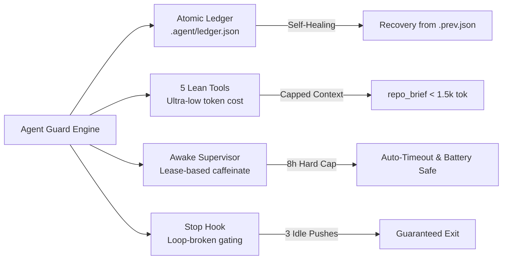

<p align="center">
  
</p>

<h1 align="center">Agent Guard</h1>

<p align="center">
  <strong>Resilient, zero-telemetry local MCP server, keep-awake supervisor, and Antigravity Stop hook for reliable autonomous pairing.</strong>
</p>

<p align="center">
  <a href="#features"></a>
  <a href="#test-suite"></a>
  <a href="#zero-telemetry"></a>
  <a href="#token-economy"></a>
  <a href="LICENSE"></a>
</p>

---

## Overview

**Agent Guard** (`agent-guard`) is a purpose-built local companion for Google Antigravity and autonomous coding agents. When working with AI coding assistants over long, complex tasks, agents frequently suffer from:
1. **Premature abandonment**: Stopping work midway before running tests or finishing subsequent steps.
2. **Context bloat & token waste**: Re-reading deep file hierarchies and receiving thousands of redundant tokens in status output.
3. **Session amnesia**: Losing task progress and state when a chat dies or hits token limits.
4. **Machine sleep**: Tasks stalling when display or idle sleep kicks in unattended.

Agent Guard solves these core failure modes with a zero-database, file-backed atomic ledger, 5 ultra-lean MCP tools, a guarded keep-awake supervisor, and an Antigravity Stop hook.

---

## Core Pillars



### 1. 🛡️ Zero-Telemetry & Strict Local Isolation
* **Zero network calls**: No telemetry, no external pings, no cloud dependencies.
* **Path Sandboxing**: All mutations are strictly jailed to `<project>/.agent/`. Refuses the home directory, filesystem root, system directories, and directories lacking `.git` or `.agent`.

### 2. ⚡ Maximum Token Economy
* Every tool is designed to conserve context window tokens:
  * `task_start`: ~150 tokens.
  * `task_checkpoint`: Single directive <= 300 characters (~60 tokens).
  * `task_status`: Compact snapshot under 500 tokens, even with 30 steps.
  * `repo_brief`: One-shot repository summary (< 1,500 tokens, hard cap at 8,000 characters) that prevents the agent from opening and reading dozens of project files.
  * `schema.ts`: Automatically truncates goals, titles, and notes with `[cut]`.
  * Logs to `.agent/log.txt` on disk; zero audit text dumped into LLM context.

### 3. 💾 Crash-Proof, Self-Healing State Ledger
* **Atomic Writes**: Writes to temporary file followed by atomic filesystem `rename`.
* **Locking & Recovery**: Concurrency locking (`.agent/ledger.lock`) with 30-second stale lock eviction.
* **Auto-Repair**: Backs up previous state to `ledger.prev.json` before each write; automatically restores valid state if corruption is detected.

### 4. 🔄 Resilient Step & Retry Machine
* **Proof Verification**: Marking a step `done` requires at least 10 characters of proof in the note (e.g. test outputs).
* **Retry Escalation**: Failed steps increment retries up to `max_tries` (default 3); automatically transitions to `blocked` once exhausted.
* **Dependency Cascading**: Automatically cascades `blocked` status to any dependent steps.
* **Deterministic Prioritization**: Next step is always chosen by strict priority: `in_progress` &rarr; `failed` with retries &rarr; first eligible `pending`.

### 5. ☕ Supervised Keep-Awake Leases
* Prevents unattended computers from sleeping during builds or multi-step execution.
* OS-specific background helpers:
  * **macOS**: `caffeinate -di -t <sec> -w <pid>` with seamless child swapping (no sleep gap) and battery discharge warnings.
  * **Windows**: PowerShell `SetThreadExecutionState` continuous wrapper.
  * **Linux**: `systemd-inhibit --what=idle:sleep`.
* Auto-expiring lease renewed at every checkpoint, guarded by an **8-hour hard ceiling**.

### 6. 🛑 Antigravity Stop Hook & Loop Breaker
* Runs via Antigravity's `.agents/hooks.json`.
* Detects premature agent stops: if unfinished, unblocked steps remain, soft-pushes the agent back to continue.
* **Embedded Loop Breaker**: If the agent makes no checkpoint progress for 3 pushes, or reaches 10 total pushes, allows stop to prevent infinite loops.
* **Fail-Safe**: Fully wrapped in exception handling; never stalls or traps the IDE.

---

## MCP Tools Reference

| Tool | Purpose | Typical Token Cost | Inputs |
| :--- | :--- | :--- | :--- |
| `task_start` | Starts a tracked task, validates step DAG, begins 30m awake lease | ~150 tokens | `goal`, `steps`, `max_tries?`, `replace?`, `project_path?` |
| `task_checkpoint` | Reports progress (`in_progress`, `done`, `failed`), verifies proof, extends lease | ~60 tokens | `step_id`, `status`, `note`, `error?`, `add_steps?`, `project_path?` |
| `task_status` | Read-only inspection of active step, blocked items, and next action | < 500 tokens | `project_path?` |
| `keep_awake` | Explicitly holds, releases, or inspects sleep inhibition lease | ~40 tokens | `action` (`hold`/`release`/`status`), `minutes?`, `reason?` |
| `repo_brief` | Fast project overview (stack, layout, entry points, rules, traps) | < 1,500 tokens | `refresh?`, `project_path?` |

---

## Installation & Configuration

### 1. Build Agent Guard
```bash
cd agent-guard
npm install
npm test
npm run build
```

### 2. Register in Antigravity
Add to `~/.gemini/config/mcp_config.json`:

```json
{
  "mcpServers": {
    "agent-guard": {
      "command": "node",
      "args": ["/full/path/to/agent-guard/dist/index.js"]
    }
  }
}
```

### 3. Install Stop Hook
Add to `.agents/hooks.json` in your target workspace:

```json
{
  "agent-guard-stop": {
    "Stop": [
      {
        "type": "command",
        "command": "node /full/path/to/agent-guard/dist/hook/stop-hook.js"
      }
    ]
  }
}
```

### 4. Configure Workspace Rules
Copy `templates/AGENT_RULES.md` into your repository's `AGENTS.md` to instruct the agent to use the tools automatically.

---

## Test Suite

Agent Guard includes comprehensive automated unit tests covering all edge cases, path traversal exploits, concurrency contention, and recovery routines:

```bash
npm test
```

```
 ✓ test/paths.test.ts (8 tests)
 ✓ test/stopHook.test.ts (4 tests)
 ✓ test/keepAwake.test.ts (5 tests)
 ✓ test/ledger.test.ts (6 tests)
 ✓ test/repoBrief.test.ts (3 tests)
 ✓ test/stepRules.test.ts (7 tests)
 ✓ test/tools.test.ts (7 tests)

Test Files  7 passed (7)
     Tests  40 passed (40)
```

---

## License

MIT License. See [LICENSE](LICENSE) for details.
