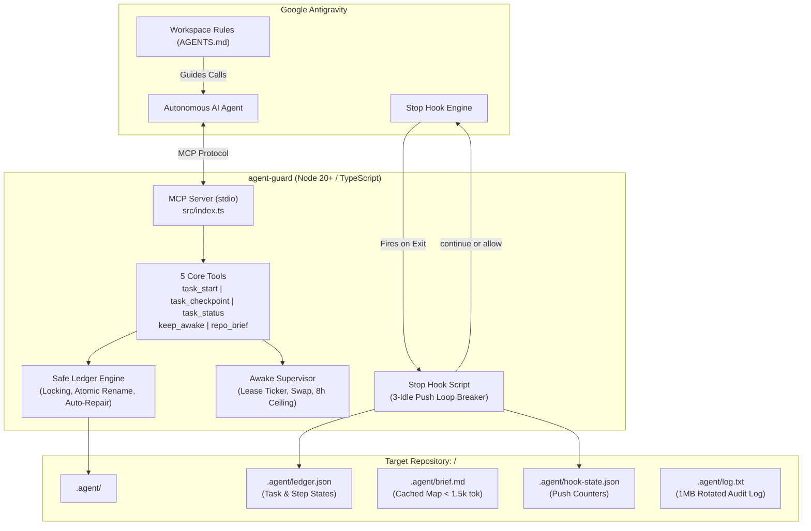

<p align="center">
  
</p>

<h1 align="center">Agent Guard</h1>

<p align="center">
  <strong>Resilient, zero-telemetry local Model Context Protocol (MCP) server, keep-awake supervisor, and Antigravity Stop hook for autonomous AI pairing.</strong>
</p>

<p align="center">
  <a href="LICENSE"></a>
  <a href="#test-suite"></a>
  <a href="#zero-telemetry"></a>
  <a href="#token-economy"></a>
  <a href="#prerequisites">= 20" /></a>
</p>

<p align="center">
  <strong>Developer</strong>: <a href="https://github.com/anksarvesh-lgtm">Sarvesh</a> |
  <strong>GitHub</strong>: <a href="https://github.com/anksarvesh-lgtm/agent-guard">anksarvesh-lgtm/agent-guard</a>
</p>

---

## Why Agent Guard?

Autonomous AI coding agents in modern IDEs like Google Antigravity excel at single-turn instructions, but frequently encounter catastrophic failure modes during extended, multi-step work:

1. **Premature Abandonment**: The agent declares victory and halts before running tests or finishing dependent steps.
2. **Context Window Bloat**: Repeatedly crawling deep file hierarchies and receiving thousands of redundant tokens in status output.
3. **Session Amnesia**: When a chat hits context limits or crashes, all task memory is lost and the agent restarts from scratch.
4. **Unattended Sleep**: Complex tasks stall midway because the computer's display or idle sleep kicks in while you step away.

**Agent Guard** (`agent-guard`) solves all four problems with zero external infrastructure:
- 💾 **File-Backed Atomic Ledger**: Keeps track of every step in `.agent/ledger.json` with self-healing recovery and concurrency locking.
- 🛑 **Antigravity Stop Hook**: Soft-blocks premature termination until all tasks are complete, with an integrated loop breaker.
- ☕ **Supervised Keep-Awake Lease**: Keeps the computer awake using native OS tools (`caffeinate`) with an 8-hour safety ceiling.
- ⚡ **Ultra-Lean Token Protocol**: 5 concise MCP tools designed from the ground up to conserve prompt tokens.

---

## System Architecture



---

## Core Pillars

### 1. 🛡️ Zero Telemetry & Local Sandboxing
* **100% Offline & Private**: Zero network dependencies, zero tracking, no cloud telemetry.
* **Strict Path Sandboxing**: Resolves canonical realpaths; strictly jails writes to `<project>/.agent/`. Disallows the root directory, user home directory, OS system folders, and paths lacking `.git` or `.agent`.

### 2. ⚡ Maximum Token Economy
* Context window consumption is minimized at every level:
  * `task_start`: Concise initialization response (~150 tokens).
  * `task_checkpoint`: Single action instruction <= 300 characters (~60 tokens).
  * `task_status`: High-density snapshot under 500 tokens, even with 30 steps.
  * `repo_brief`: Fast, one-shot repository summary (< 1,500 tokens; hard cap at 8,000 characters) that prevents the agent from crawling dozens of files.
  * Automatic string truncation with `[cut]` for goals (500 chars), titles (200 chars), and notes (500 chars).
  * Disk-only rotation logging (`.agent/log.txt` at 1MB); zero debug spam injected into model context.

### 3. 💾 Crash-Proof, Self-Healing State Ledger
* **Atomic Writes**: Writes to `.agent/ledger.tmp` followed by atomic filesystem `rename`.
* **Lock Contention**: Concurrency locking (`.agent/ledger.lock`) with 30-second stale lock eviction.
* **Automatic Recovery**: Backs up prior state to `ledger.prev.json` before writing; automatically self-heals and restores state if corruption is ever detected on read.

### 4. 🔄 Resilient Step & Retry Machine
* **Proof Verification**: Marking a step `done` requires at least 10 non-whitespace characters of verification proof in the note (e.g. test outputs or compile results).
* **Retry Escalation**: Failed steps increment retries up to `max_tries` (default 3); automatically transitions to `blocked` once exhausted.
* **Dependency Cascading**: Automatically cascades `blocked` status to any dependent steps down the DAG.
* **Strict Prioritization**: The next step is always selected deterministically:
  $$\text{in\_progress} \longrightarrow \text{failed (with retries)} \longrightarrow \text{first ready pending}$$

### 5. ☕ Supervised Keep-Awake Leases
* Prevents unattended computers from sleeping during long builds, tests, or multi-step execution.
* Native OS helpers:
  * **macOS**: `caffeinate -di -t <sec> -w <pid>` with seamless child swapping (no sleep gap) and battery discharge warnings.
  * **Windows**: PowerShell `SetThreadExecutionState` continuous wrapper.
  * **Linux**: `systemd-inhibit --what=idle:sleep`.
* Auto-expiring lease renewed at every checkpoint, guarded by an **8-hour hard ceiling**.

### 6. 🛑 Antigravity Stop Hook & Loop Breaker
* Wired via Antigravity's `.agents/hooks.json`.
* Detects premature agent stops: if unfinished, unblocked steps remain, soft-pushes the agent back to continue.
* **Loop Breaker**: If the agent makes no checkpoint progress for 3 consecutive pushes, or reaches 10 total pushes, allows stop to prevent runaway loops.
* **Fail-Safe**: Fully wrapped in exception handling; never stalls or traps the IDE.

---

## MCP Tools Reference

| Tool | Purpose | Token Cost | Inputs |
| :--- | :--- | :--- | :--- |
| `task_start` | Starts a tracked task, validates step DAG, begins 30m awake lease | ~150 tokens | `goal`, `steps`, `max_tries?`, `replace?`, `project_path?` |
| `task_checkpoint` | Reports progress (`in_progress`, `done`, `failed`), verifies proof, extends lease | ~60 tokens | `step_id`, `status`, `note`, `error?`, `add_steps?`, `project_path?` |
| `task_status` | Read-only inspection of active step, blocked items, and next action | < 500 tokens | `project_path?` |
| `keep_awake` | Explicitly holds, releases, or inspects sleep inhibition lease | ~40 tokens | `action` (`hold`/`release`/`status`), `minutes?`, `reason?` |
| `repo_brief` | Fast project overview (stack, layout, entry points, rules, traps) | < 1,500 tokens | `refresh?`, `project_path?` |

---

## Quickstart & Installation

For the comprehensive setup manual and deep-dive troubleshooting, see the [Installation Guide (INSTALL.md)](INSTALL.md).

### ⚡ 1-Click Universal Git Install
Clone and install Agent Guard with a single command on any machine:

```bash
git clone https://github.com/anksarvesh-lgtm/agent-guard.git ~/.agent-guard && ~/.agent-guard/install.sh
```

Or from an existing local clone:
```bash
cd agent-guard
./install.sh
```

---

## 🛠️ Configuring Your AI Coding App

Agent Guard operates as a standard [Model Context Protocol (MCP)](https://modelcontextprotocol.io/) server over `stdio`. Use the configuration snippet below for your environment:

<details open>
<summary><strong>1. Google Antigravity (IDE, App 2.0, CLI <code>agy</code>)</strong></summary>

The automated installer configures Antigravity automatically. To configure manually, add to `~/.gemini/config/mcp_config.json`:

```json
{
  "mcpServers": {
    "agent-guard": {
      "command": "node",
      "args": ["/absolute/path/to/agent-guard/dist/index.js"]
    }
  }
}
```

**Antigravity Stop Hook** (`.agents/hooks.json` in your workspace):
```json
{
  "agent-guard-stop": {
    "Stop": [
      {
        "type": "command",
        "command": "node /absolute/path/to/agent-guard/dist/hook/stop-hook.js"
      }
    ]
  }
}
```
</details>

<details>
<summary><strong>2. Claude Code CLI</strong></summary>

Add with a single CLI command:
```bash
claude mcp add agent-guard -- node /absolute/path/to/agent-guard/dist/index.js
```

Or add to `~/.claude/mcp.json`:
```json
{
  "mcpServers": {
    "agent-guard": {
      "command": "node",
      "args": ["/absolute/path/to/agent-guard/dist/index.js"]
    }
  }
}
```
</details>

<details>
<summary><strong>3. Cursor IDE</strong></summary>

Navigate to **Settings &rarr; Features &rarr; MCP &rarr; Add New MCP Server**, or edit `~/.cursor/mcp.json`:

```json
{
  "mcpServers": {
    "agent-guard": {
      "command": "node",
      "args": ["/absolute/path/to/agent-guard/dist/index.js"]
    }
  }
}
```
</details>

<details>
<summary><strong>4. Windsurf (Codeium / Cascade)</strong></summary>

Add to `~/.codeium/windsurf/mcp_config.json`:

```json
{
  "mcpServers": {
    "agent-guard": {
      "command": "node",
      "args": ["/absolute/path/to/agent-guard/dist/index.js"]
    }
  }
}
```
</details>

<details>
<summary><strong>5. VS Code (Cline / Roo Code / Continue)</strong></summary>

Add to `cline_mcp_settings.json`:

```json
{
  "mcpServers": {
    "agent-guard": {
      "command": "node",
      "args": ["/absolute/path/to/agent-guard/dist/index.js"],
      "disabled": false,
      "autoApprove": [
        "task_start",
        "task_checkpoint",
        "task_status",
        "repo_brief",
        "keep_awake"
      ]
    }
  }
}
```
</details>

<details>
<summary><strong>6. Zed Editor</strong></summary>

Add to `~/.config/zed/settings.json`:

```json
{
  "experimental": {
    "model_context_protocol": {
      "servers": {
        "agent-guard": {
          "command": "node",
          "args": ["/absolute/path/to/agent-guard/dist/index.js"]
        }
      }
    }
  }
}
```
</details>

---

## 🎯 Target Workspace Setup

To enable Agent Guard's autonomous supervision in any target project:

```bash
./install.sh --workspace "/path/to/your/project"
```

This installs:
1. **`.agents/hooks.json`**: Prevents the agent from abandoning work before all steps are complete and verified.
2. **`AGENTS.md`**: Provides clear system instructions directing the model to start tasks, inspect code maps before touching files, verify work with >= 10-char proof notes, and retry failed steps before continuing.

---

## Verification & Doctor

Agent Guard includes a built-in diagnostic doctor to verify all integrations:

```bash
npm run doctor
```

```
🩺 Agent Guard Readiness Doctor

• Node version:    v24.22.0 (/path/to/node)
• MCP Config:      [OK] agent-guard is registered in mcp_config.json
• Server Binary:   [OK] dist/index.js
• Hook Binary:     [OK] dist/hook/stop-hook.js
• Sleep Inhibitor: [OK] macOS caffeinate available
```

Run the automated test suite:

```bash
npm test
```

```
Test Files  7 passed (7)
     Tests  40 passed (40)
  Duration  564ms
```

---

## 👨‍💻 Developer & Author

* **Developer**: **Sarvesh** ([@anksarvesh-lgtm](https://github.com/anksarvesh-lgtm))
* **Project Repository**: [https://github.com/anksarvesh-lgtm/agent-guard.git](https://github.com/anksarvesh-lgtm/agent-guard.git)

Contributions, feature suggestions, and pull requests are warmly welcomed! Please see [CONTRIBUTING.md](CONTRIBUTING.md).

---

## Free Software License

Agent Guard is free and open-source software licensed under the **[Apache License, Version 2.0](LICENSE)**.

You are free to use, modify, distribute, and embed Agent Guard for personal, academic, or commercial purposes. See the [`LICENSE`](LICENSE) file for the full license text.
