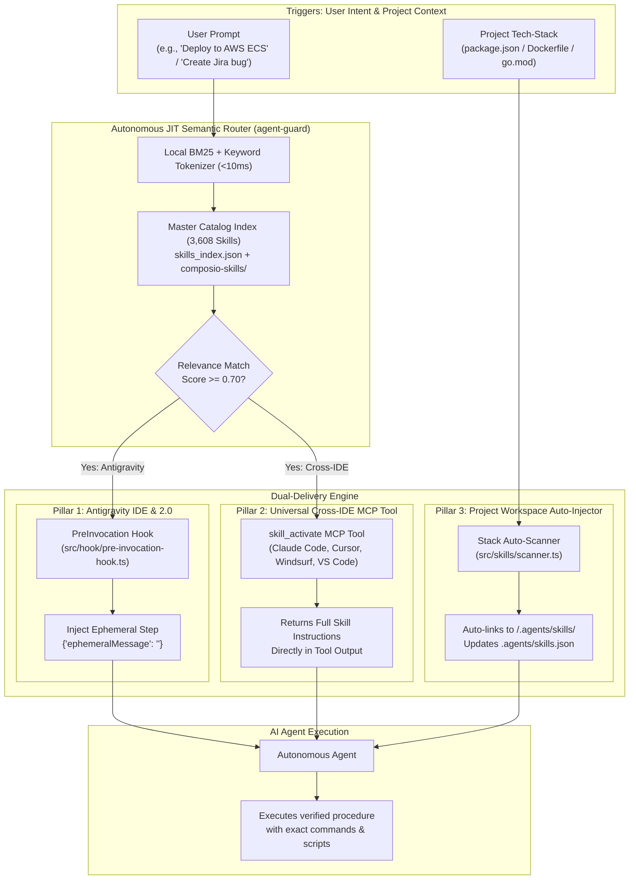
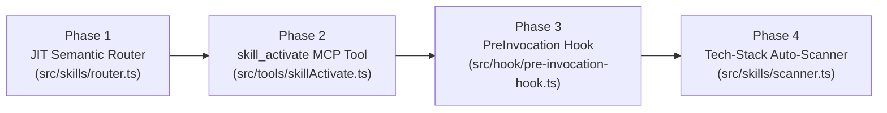

# 🧠 Autonomous Dynamic Skill Activation Engine
## Architectural Design & Implementation Plan for JIT Skill Orchestration

> **Target Capability**: Enable any of the **3,608 skills** in the master catalog to automatically activate **just-in-time (JIT)** in **any project** and work seamlessly with **any AI agent** (Google Antigravity, Claude Code, Cursor, Windsurf, VS Code), without bloating the model's system prompt context window.

---

## 1. Problem Statement & Context Budget Paradox

Modern AI agents rely on procedural skills (`SKILL.md`) to execute complex development runbooks. However, scaling beyond a few dozen skills introduces the **Context Bloat Paradox**:

```
Static Pre-loading:  3,608 skills × ~50 tokens/description = ~180,400 tokens / prompt
```
- **Context Window Exhaustion**: Consumes 10% to 20% of the entire model context budget on every single turn before reading any project code.
- **Attention Degradation**: Needle-in-a-haystack dilution causes models to overlook relevant skills or hallucinate instructions.
- **Latency & Compute Cost**: Slower time-to-first-token and massive API token burn.

### The Solution: Multi-Tier Just-In-Time (JIT) Dynamic Activation
Keep a lean **Tier 1 (78 core skills)** in the active prompt, and dynamically stream, inject, and link specialized skills from **Tier 2 (832 Composio SaaS skills)** and **Tier 3 (2,749 Awesome community skills)** the exact instant a task or prompt requires them.

---

## 2. System Architecture



---

## 3. The Three Activation Pillars

### Pillar 1: Ambient Zero-Turn PreInvocation Hook (Google Antigravity)
Leverages Google Antigravity's native `PreInvocation` hook lifecycle event:
- **Hook Script**: `src/hook/pre-invocation-hook.ts` (configured in `.agents/hooks.json`).
- **Input Received**: Reads `transcriptPath` from `stdin`, obtaining the user's latest prompt.
- **Evaluation**: Runs local BM25 token matcher against the 3,608 skill index in **< 8 milliseconds**.
- **Action**:
  - If a high-confidence match ($\ge 0.75$) is detected that is not already in prompt:
    1. Reads the skill's complete `SKILL.md`.
    2. Injects an `ephemeralMessage` via the hook's JSON stdout response:
       ```json
       {
         "injectSteps": [
           {
             "ephemeralMessage": "💡 [Agent Guard JIT Skill Activation] Detected workflow intent for '<skill-id>'. Activating verified procedural runbook:\n\n<FULL_SKILL_MD_CONTENT>"
           }
         ]
       }
       ```
    3. The AI agent immediately possesses the exact commands, scripts, and rules for that turn—**zero extra user prompts required**.

### Pillar 2: Universal `skill_activate` MCP Tool (Cross-IDE Standard)
Works across all AI coding assistants (Claude Code, Cursor, Windsurf, VS Code, Zed):
- **MCP Tool Name**: `skill_activate`
- **Schema**:
  ```typescript
  {
    name: "skill_activate",
    description: "Dynamically activates and injects specialized procedural runbooks from the 3,600+ master skill library. Use whenever you need procedures for any cloud API, framework, language, database, or tool.",
    parameters: {
      query: { type: "string", description: "The workflow, framework, service, or task (e.g. 'stripe webhooks', 'prisma migration', 'docker compose', 'jira automation')" },
      project_path: { type: "string", description: "Current workspace directory" },
      auto_install: { type: "boolean", description: "Whether to link permanently into .agents/skills/ (default: true)" }
    }
  }
  ```
- **Behavior**:
  - Searches 3,608 catalog instantly.
  - Returns complete instructions, script paths, and usage examples directly in the tool response.
  - Automatically symlinks/copies the skill into `<project>/.agents/skills/<skill-id>` and updates `<project>/.agents/skills.json`.

### Pillar 3: Workspace Tech-Stack Auto-Detector
Proactively activates skills based on repository anatomy upon workspace initialization or `task_start`:
- **Detection Rules**:
  | File Pattern / Dependency Detected | Automatically Activated Skills |
  | :--- | :--- |
  | `package.json` with `next`, `react`, `vue` | `frontend-ui-engineering`, `artifacts-builder`, `ui-ux-pro-max`, `web-artifacts-builder` |
  | `Dockerfile`, `docker-compose.yml`, `k8s/` | `devops-automation`, `ci-cd-and-automation` |
  | `prisma/`, `drizzle.config.ts`, `migrations/` | `deprecation-and-migration`, `api-and-interface-design` |
  | `go.mod` | `clean-architecture`, `test-driven-development` |
  | `requirements.txt` with `fastapi`, `flask`, `torch` | `api-and-interface-design`, `model_compressor` |
- **Mechanism**: Writes a workspace-level `.agents/skills.json` pointing to matching catalog folders without copying files, keeping the workspace git tree clean.

---

## 4. Latency, Memory & Security Specifications

1. **Sub-10ms Local Execution**:
   - The 3,608 skill index is pre-compiled into an inverted memory trie (`skills_trie.json`).
   - Zero external HTTP requests; 100% offline local memory search.
2. **Deterministic Fallbacks**:
   - If match score $< 0.50$, the hook yields `{ "injectSteps": [] }` without altering prompt flow.
   - If multiple candidates match ($0.50 - 0.74$), the tool returns a 3-bullet disambiguation picker.
3. **No Workspace Pollution**:
   - Uses symbolic links or ephemeral injection by default.
   - Avoids copying hundreds of megabytes of skill files into repositories.

---

## 5. Implementation Roadmap & Milestones



### Phase 1: In-Memory JIT Semantic Router (`src/skills/router.ts`)
- Pre-indexes all 3,608 skills (Curated: 71, Composio: 832, Awesome: 2,749).
- Fast BM25 + exact-token scoring algorithm.
- Unit test coverage with 100+ sample queries verifying $<10$ms execution.

### Phase 2: `skill_activate` MCP Tool (`src/tools/skillActivate.ts`)
- Implements tool handler in `agent-guard` server.
- Exposes `skill_activate` in `mcp_config.json` autoApprove lists across all IDE targets.
- Writes `<project>/.agents/skills.json` entries on demand.

### Phase 3: Ambient PreInvocation Hook (`src/hook/pre-invocation-hook.ts`)
- Registers `PreInvocation` in `.agents/hooks.json` and `templates/plugin/agent-guard/hooks.json`.
- Safely reads latest user turn from `transcriptPath`.
- Outputs valid `ephemeralMessage` protobuf structure without crashing language server.

### Phase 4: Tech-Stack Auto-Scanner & CLI Subcommand
- Adds `agent-guard skills scan [project_path]` to CLI.
- Automatically executes during `task_start` and `node dist/cli.js install`.

---

## 6. Verification & Test Plan

1. **Routing Accuracy Tests**:
   - Test queries for SaaS apps (`"create jira ticket"`, `"charge stripe customer"`, `"send slack alert"`).
   - Test queries for developer workflows (`"write word report"`, `"audit security vulnerabilities"`, `"optimize postgres query"`).
2. **Antigravity Hook End-to-End Simulation**:
   - Verify `pre-invocation-hook.js` receives `transcriptPath`, matches skill, and emits valid JSON with `injectSteps`.
3. **Vitest Regression Suite**:
   - Maintain 100% passing rate across all 16 Vitest test suites.
