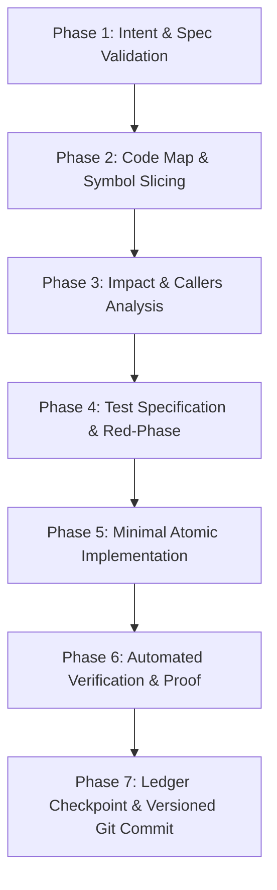

# ⚡ 7-Phase Prompt Execution Framework (Agent Guard Edition)

  

> **Maintained by Sarvesh ([@anksarvesh-lgtm](https://github.com/anksarvesh-lgtm)) | Supervised by `@agent-guard`**
> *Zero-Telemetry • Local-First • Autonomous Task Guarding*

---

## 🎯 Purpose & Overview
LLM agents make the most errors when attempting to solve large, ambiguous requests in a single leap. The **7-Phase Prompt Executor** splits any complex engineering prompt into 7 gate-checked phases. Each phase has a hard pass check; an agent cannot proceed to the next phase until the current phase's verification proof is obtained.

---

## 🔄 The 7 Checked Phases

---

### Phase 1: Intent & Specification Validation
- **Objective**: Clarify requirements, constraints, interfaces, edge cases, and non-goals before touching code.
- **Actions**:
  1. Call `task_status` to inspect active ledger state.
  2. If none active, call `repo_brief` and initialize with `task_start` defining 3 to 12 clear steps.
  3. Identify user boundaries, environment parameters, and error modes.
- **Pass Gate**: Concrete acceptance criteria and step DAG recorded in `.agent/ledger.json`.

---

### Phase 2: AST Code Map & Symbol Slicing
- **Objective**: Discover code symbols without re-reading whole files or inflating context.
- **Actions**:
  1. Call `code_map({ action: 'lookup', symbol_name: '...' })` or `code_map({ action: 'overview' })`.
  2. Use `code_map({ action: 'slice', symbol_name: '...' })` to inspect the exact lines of target symbols.
  3. Avoid reading 500+ line files when only a 30-line function or class signature is needed (cuts token consumption by 90%+).
- **Pass Gate**: Target functions, classes, and types pinpointed with exact file paths and line ranges.

---

### Phase 3: Impact & Callers Analysis
- **Objective**: Map call chains and prevent unintended breaking changes across dependents.
- **Actions**:
  1. Call `code_map({ action: 'callers', symbol_name: '...' })` to locate all call sites and import references.
  2. Verify if public API signatures or contracts are changing.
  3. Ensure backward compatibility or plan atomic migrations.
- **Pass Gate**: Complete list of callers and dependent modules verified.

---

### Phase 4: Test Specification & Red-Phase Setup
- **Objective**: Establish reproducible verification before writing production code.
- **Actions**:
  1. Locate or create unit / integration tests in the test suite.
  2. Write a failing test asserting the expected behavior, edge case, or bug fix.
  3. Run test runner (e.g., `npm test`, `pytest`, `cargo test`) to confirm failure mode.
- **Pass Gate**: Reproducible test failure or automated baseline check established.

---

### Phase 5: Minimal Atomic Implementation
- **Objective**: Implement the surgical code modification with minimal diff footprint.
- **Actions**:
  1. Make targeted, cohesive edits to only the necessary files.
  2. Avoid drive-by refactoring or altering unrelated comments, formats, or dependencies.
  3. Adhere to project architectural standards (`AGENTS.md`).
- **Pass Gate**: Clean compilation (`npm run build`, `tsc`, `cargo build`) with zero diagnostic errors.

---

### Phase 6: Automated Verification & Proof Generation
- **Objective**: Prove correctness with hard, falsifiable evidence.
- **Actions**:
  1. Execute the full test suite (`npm test`).
  2. Run linters and type checkers.
  3. Capture test summary output (pass count, duration).
- **Pass Gate**: 100% test suite passing; concrete output string ready for checkpoint note.

---

### Phase 7: Ledger Checkpoint & Clean Git Commit
- **Objective**: Persist state, release lock, and commit changes cleanly.
- **Actions**:
  1. Call `task_checkpoint({ step_id, status: 'done', note: '...' })` with test proof.
  2. Commit changes with a conventional commit message.
  3. If pushing to remote, bump version by `.1` (+0.0.1 via `npm run bump`) before push.
- **Pass Gate**: Step marked `done` in `.agent/ledger.json` and git working tree clean.

---

## 🛡️ Error Recovery Protocol
If any phase fails or an error is encountered:
1. Immediately call `task_checkpoint({ step_id, status: 'failed', error: '...' })`.
2. Review the error message and call `code_map({ action: 'lookup' })` to diagnose root cause.
3. Fix the underlying fault and retry the current step.
4. If a step fails 3 consecutive times, mark as `blocked` and notify supervisor.
